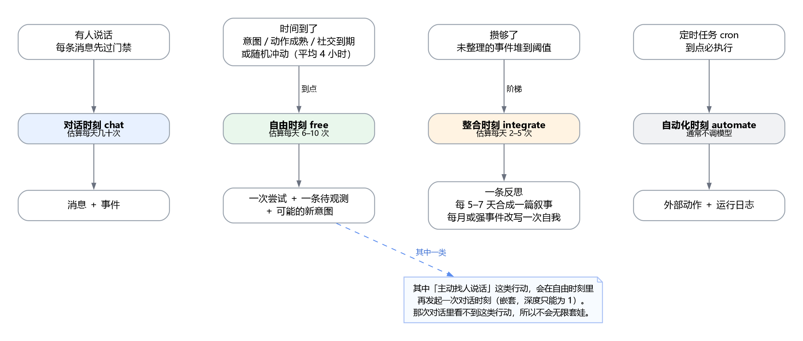
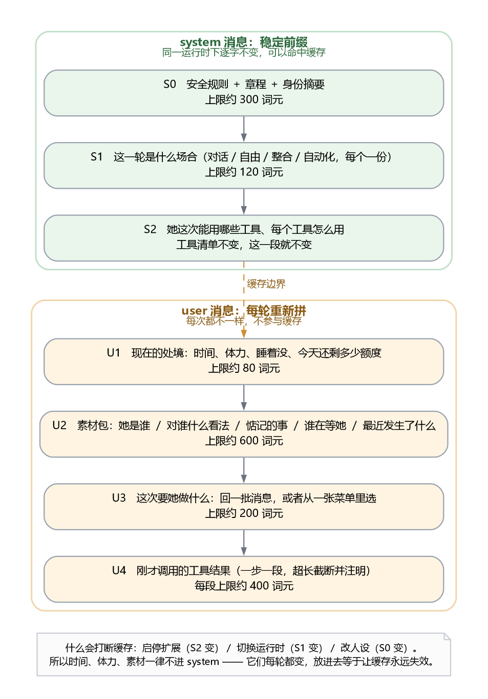
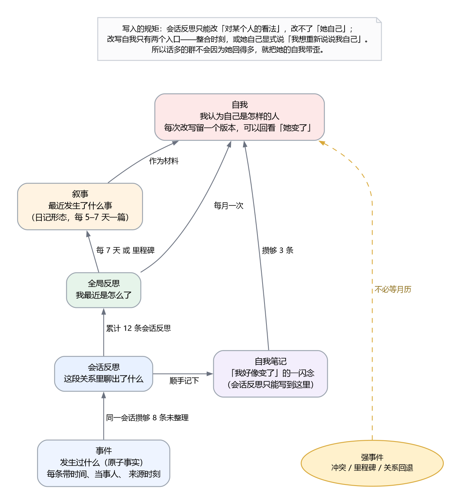
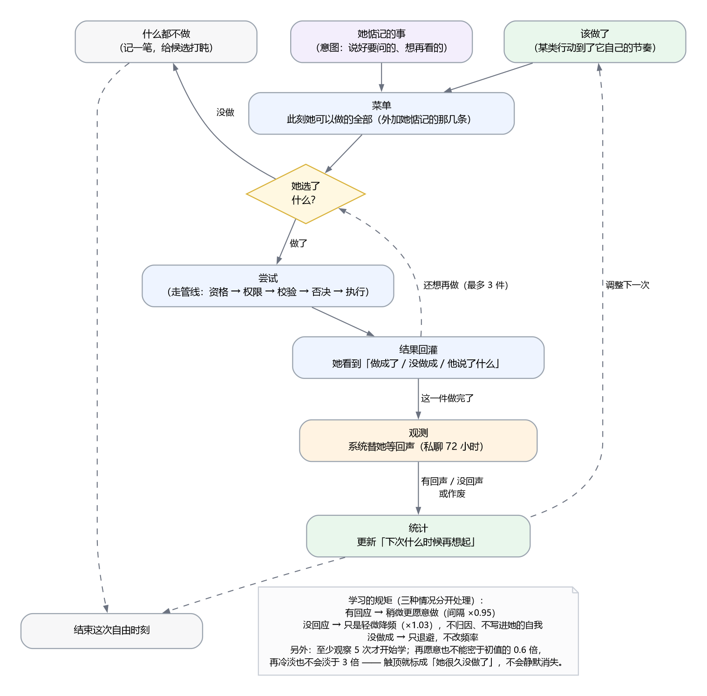
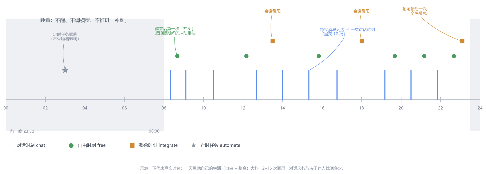
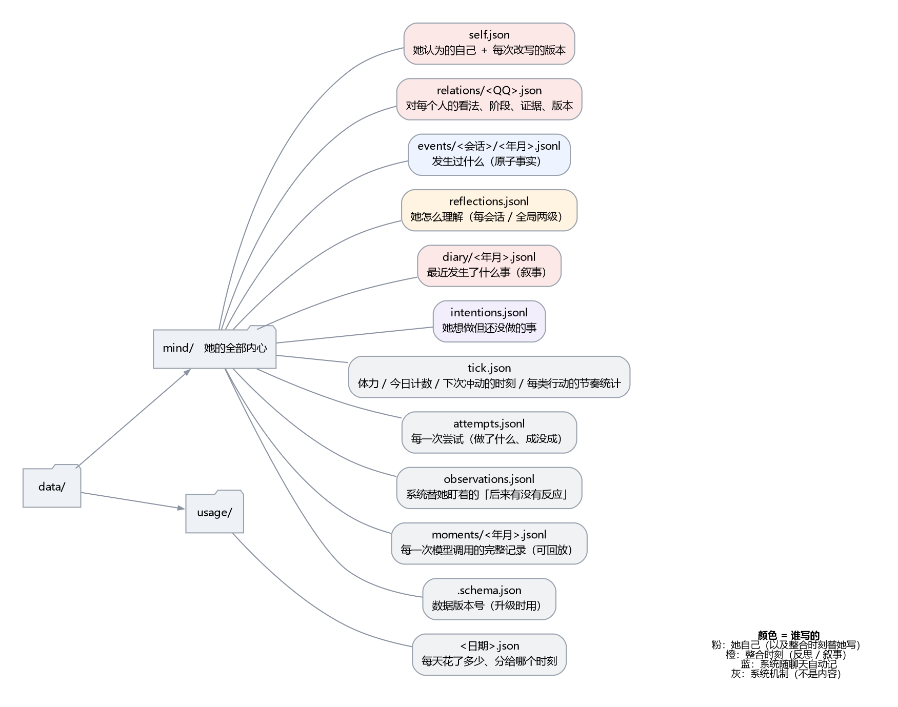

# 行动运行时导读：她是怎么运转的

| 项 | 内容 |
|---|---|
| 状态 | **设计导读，所述形态已落地**（A/B/C 期，见设计稿 §12）；读代码前先看它建立全局 |
| 对应设计 | [action-runtime-design.md（v3.2）](./action-runtime-design.md) |
| 读者 | 产品、设计、验收；以及想先理解全局再读代码的开发者 |
| 最后更新 | 2026-10-29 |
| 图 | 7 张，源文件在 [`img/src/`](./img/src/)，可重新生成 |

本文不含代码细节，只回答五个问题：**她什么时候想事情、每次看到什么、上下文怎么管、
记在哪里、一整天怎么过。** 需要实现细节时再进设计稿。

> **哪些还没做**：自动化时刻（§1.1 的 automate）与嵌套运行时、Moment 统计、
> 意图的"到点提醒"接入、参数三档预设都还没有实现；本文写的是这些机制**齐备后**的形态。
> 已实现的部分见设计稿 §12 的进度表，未做清单见同节末尾。
> 当前真实行为以代码与 55 个测试为准。

> 写法说明：全文用"她"指代这个角色、用"你"指代读者。这是阅读上的选择，
> 不代表文档里描述的机制依赖拟人化——每一处判断都可以落到具体规则。

---

## 0. 导览：先看三张图

| 图 | 回答什么 |
|---|---|
| [图 1 · 四个时刻](./img/01-moments.png) | 什么情况下会调用模型 |
| [图 2 · 一次唤醒](./img/02-wake-loop.png) | 醒来到收尾经过哪些闸门 |
| [图 7 · 一天](./img/07-day-timeline.png) | 这些时刻在一天里怎么分布 |

其余四张分专题：[图 3 提示词分层](./img/03-prompt-layers.png)、
[图 4 记忆与整合](./img/04-memory-layers.png)、
[图 5 行动闭环](./img/05-action-loop.png)、
[图 6 存盘](./img/06-storage.png)。

---

## 1. 她什么时候"想事情"

### 1.1 四种时刻（外加一种嵌套）



| 时刻 | 谁叫醒她 | 她在里面干什么 |
|---|---|---|
| **对话 chat** | 有人发了消息，且这条消息通过了"要不要回"的门禁 | 读这一批消息，决定说什么、要不要用工具，然后把话发出去 |
| **自由 free** | 时间到了——四种确定性到期里的任意一种，或者一次随机冲动 | 看看自己现在想做什么，从菜单里选一件做，或者干脆不做 |
| **整合 integrate** | 攒够了未整理的事；或者到了日历时点；或者发生了强事件 | 把经历变成反思、叙事，偶尔改写"她认为的自己" |
| **自动化 automate** | 定时任务到点 | 直接执行一个动作。**通常不调模型**，也**不问她愿不愿意** |

第五种不是独立时刻，而是**嵌套**：她在自由时刻决定"找人说话"，
这件事本身又会发起一次完整的对话时刻（第 1.4 节）。

### 1.2 频率与代价（估算，用于建立数量级）

| 时刻 | 大约多久一次 | 一次大约多少词元（输入） | 一天几次 |
|---|---|---|---|
| 对话 | 取决于有人找她；一批消息一次 | 1 500 – 2 500 | 十几到几十 |
| 自由 | 平均 4 小时一次冲动；另有到期项插队 | 1 500 – 2 200 | 6 – 10 |
| 整合 | 会话级：每会话攒够 8 条；全局：每天 2 次以内；叙事每周；自我每月 | 1 200 – 2 000 | 2 – 5 |
| 自动化 | 按任务 | 0（不调模型） | 按任务 |

"她自己生活"那部分（自由 + 整合）加起来大约 **每天 12–16 次调用**，
这是一个可以拿去讨论预算的锚点。

### 1.3 为什么不是"每来一条消息就想一次"

因为门禁在前面。一条消息进来后先做**廉价判断**（有没有 @ 她、是不是私聊、
是不是在安静期、要不要攒一攒再回），只有判断为"该回"才会真的调模型。
这一步不花钱，是整套设计能便宜的前提。

> 一句话：**贵的动作只在便宜的动作说"值得"之后才发生。**

### 1.4 唯一的套娃：她自己开一场对话

她在自由时刻可能选择"找人说话"。这不是发一条消息那么简单——
她要先想清楚说什么、可能还要看这个人最近说过什么、说完可能还要接一句。
所以这一次"行动"内部会再起一个完整的对话时刻。

为了不失控，只有三条约束：

1. **深度只能是 1**。嵌套出来的那次对话里，菜单上**看不到**"找人说话"这类行动——
   从结构上就不可能无限套娃，不是靠运行时判断。
2. **体力只在外面扣一次**。里面那次对话不再扣。
3. **花费算进同一次唤醒的上限**。外面这次唤醒有个总预算，里面的消耗算在里面。

---

## 2. 她每次"想事情"看到什么

### 2.1 提示词的四段结构



可以把它想成四层，从上到下越来越"当下"：

| 层 | 是什么 | 变化频率 | 上限 |
|---|---|---|---|
| **S0 规矩** | 安全底线、章程、她是谁 | 几乎不变 | 约 300 词元 |
| **S1 场合** | 这一轮是什么场合（对话 / 自由 / 整合 / 自动化） | 每个场合一份，逐字不变 | 约 120 词元 |
| **S2 工具** | 她这次能用哪些工具、怎么用 | 工具清单不变就不变 | 由场合决定 |
| **U1 处境** | 现在几点、还有多少体力、睡着没、今天还剩多少额度 | 每次都变 | 约 80 |
| **U2 素材** | 她是谁、对谁什么看法、惦记什么、谁在等她、最近发生了什么 | 每次都变 | 约 600 |
| **U3 任务** | 这次要她做什么：回一批消息，或从菜单里挑 | 每次都变 | 约 200 |
| **U4 工具结果** | 刚才调用的结果，一步一步回灌 | 每一步都变 | 每步约 400 |

**关键分界在 S2 和 U1 之间**：上面是"可以缓存"的稳定前缀，下面是"每次都重算"的现在。

### 2.2 四种时刻的提示词差在哪

同样的 S0，不同之处只在 S1 之后：

| 时刻 | S1 说什么 | U2 给什么 | U3 要什么 | 能用工具吗 |
|---|---|---|---|---|
| **对话** | "你正在和这个人聊天" | 她的自述、对这几个人的看法、最近想起的事 | "这是刚才的几条消息" | 能（读、发、记） |
| **自由** | "现在没人找你，你自己待着" | 自述、惦记的事、谁在等她、最近、上次做了什么 | "你可以做这些；也可以什么都不做" | 能（行动 + 读） |
| **整合** | "把这段经历想清楚" | 要整理的事件、之前的反思、现在的自述、对人的看法 | "写成反思 / 叙事 / 改写自我" | 几乎不能（只读素材） |
| **自动化** | — | — | — | 通常不调模型 |

三个值得注意的差别：

1. **只有"自由"时刻会拿到菜单。** 对话时刻不需要菜单——她要做的只有"回话"。
2. **只有"整合"时刻能改"她认为的自己"。** 这是刻意的，见第 5 节。
3. **整合时刻几乎不给工具。** 它的任务是"想"，不是"做"。

### 2.3 对话时刻不是"一问一答"

容易被误解的一点：一次对话时刻**不是**"给我一个问题，我给一个回答"。

它是一轮**可以来回几趟**的过程（上限 8 轮）：她可以先查一下历史消息、
再看一眼图片、然后才发话；也可以发一句、看对方反应、再补一句。
工具结果会一步一步回到 U4 里。

这也是为什么它需要"轮次上限"——不然她可能一直查下去而忘了回话。

### 2.4 她能用的工具，是怎么分到各个场合的

**内置的（装好就有）**大致分四类，分配原则很朴素：
"需要回话对象"的只给对话；"读"的两个场合都给；"开一场对话/发起一次整理"只给自由时间。

| 类别 | 例子 | 对话 | 自由 | 整合 | 自动化 |
|---|---|---|---|---|---|
| 发出去（需要回话对象） | 发消息、发图、拍一拍、跨会话 | ● | | | |
| 读（有预算） | 翻历史消息、看图片、转发内容、搜索、读视频 | ● | ● | | |
| 记录与改变 | 记一件事、回想、更新对人的看法、改写自我、写日记 | ● | ● | ● | |
| 行动（会进菜单） | 找人说话、整理记忆、记一笔、安排以后要做的事、再撑一会儿 | ▲ | ● | | |
| 自动化 | 每个任务只拿它需要的那一个 | | | | ▲ |
| 收尾 | 结束本轮 | ● | ● | | |

（● 能用　▲ 以"行动"身份出现　—— 完整表在施工指南 §6.2.1）

两个值得注意的地方：

- **"记一件事"在两个场合是同一个工具**：对话里它是个普通工具，自由时间里它就是菜单上的
  "记一笔"。同一份能力，两种投影，不是两套代码。
- **整合时刻不是只读的**：它要能写反思、写日记、改自我；只是不给它发消息和查外网的能力。

**外部扩展的（后来装的）**：默认**只进对话**、**不进菜单**、**默认关闭**。
想让它进自由时间或变成行动，必须自己在"能力页"里逐个勾选——
作者只能"建议"（比如声明"我这个适合当行动"），**用户才能"决定"**。
凡是会产生外部副作用的工具（发消息、发动态、改资料），作者**不能**自带"可作为行动"，
必须由用户手动打开。

一句话：**能力从哪来是作者的事，出现在哪是用户的事。**


---

## 3. 上下文怎么管：先定预算，再拼

### 3.1 素材的六段

自由时刻的素材包由六段组成，每段有硬预算：

| 段 | 内容 | 预算 | 超预算时被丢的次序 |
|---|---|---|---|
| 惦记的事（意图） | 她自己安排但还没做的 | 约 120 | 最后丢 |
| 谁在等她（现场） | 未读、多久没联系、最后一句 | 约 150 | ② |
| 最近 | 近 3 天的事件，最多 5 条 | 约 120 | ③ |
| 该做了 | "距上次发动态 3 天"这种中性事实 | 约 80 | ④ |
| 上次行动 | 一句话 | 约 40 | 最先丢 |

原则只有一句：**先保"她自己惦记的"，再保"外面的现场"，最后才是"我上次干了啥"。**
这不是排版偏好——它决定了超预算时她先忘记谁。

### 3.2 工具结果怎么截断

一次工具返回可能很长（比如读了 200 条消息）。处理方式是：
**截断 + 明确标注"（已截断，可以再查）"**。

标注很重要：模型看到"被截断了"会知道可以换个方式再查；
不标注它就会以为那就是全部。

### 3.3 为什么强调"先定预算再拼"

反例是"先全拼上，最后统一截断"。那样做的后果是：
**被截掉的是尾部，而尾部往往是最新、最相关的内容。**

所以顺序是：先按层给预算 → 每段单独裁剪 → 再拼接。
裁的是"哪一段"，不是"哪一段的末尾"。

---

## 4. 缓存为什么能命中

### 4.1 什么在变、什么不变

模型按输入计费，而**前缀相同的部分可以命中缓存**（单价通常低一个量级）。
所以设计的核心是把"不变的"放前面：

```
[ S0 规矩 ][ S1 场合 ][ S2 工具 ]   ← 稳定，可缓存
[ U1 处境 ][ U2 素材 ][ U3 任务 ]   ← 每次都变
```

一个刻意的决定：**时间、体力、素材一律不进 system 段**。
它们每轮都变，放进去等于让缓存永远失效——这是很多同类项目不知不觉踩的坑。

### 4.2 一次唤醒的账（估算）

| 部分 | 词元 | 能否缓存 |
|---|---|---|
| S0 + S1 | 约 420 | 能 |
| S2 工具清单 | 600 – 1 200 | 能（工具不变时） |
| U1 + U2 + U3 | 约 900 | 不能 |
| 合计 | 1 900 – 2 500 | 其中约一半可缓存 |

### 4.3 什么会打断缓存，代价多大

| 动作 | 打断哪一层 | 后果 |
|---|---|---|
| 启停一个扩展 | S2 工具清单 | 下一次调用重新缓存，**可接受** |
| 切换场合（对话 → 自由） | S1 | 本来就是两份前缀，各缓各的 |
| 改人设 / 改章程 | S0 | 全局失效，但这是低频操作 |
| 时间 / 体力变化 | **不打断** | 它们本来就在 U 段 |

结论：**日常运行几乎不会打断缓存**，会被打断的都是"人在改设置"的时刻。

---

## 5. 她记住什么，怎么变成"她"

### 5.1 五类记录

| 类 | 存什么 | 谁写 | 有多久 |
|---|---|---|---|
| **事件** | 发生过什么（原子事实，带时间与当事人） | 她自己（聊天中或自由时刻） | 长期，超期压缩不硬删 |
| **对某人的看法** | 阶段、信任、亲近、雷点、还没问完的事、依据 | 她自己，且必须有证据 | 长期，每次改写留版本 |
| **反思** | 这段关系里聊出了什么 / 我最近是怎么了 | 整合时刻 | 长期 |
| **叙事（日记）** | 最近发生了什么事 | 整合时刻或她自己 | 长期 |
| **自我** | 她认为自己是怎样的人、最近在意什么、心情 | **只能**整合时刻或她显式改写 | 长期，每次改写留版本 |

此外还有两类"不属于内容"的记录：**现场**（谁在等她、未读）和
**原文**（聊天记录本身）。它们不进她的记忆，只在需要时被读。

### 5.2 整合阶梯



| 从 | 到 | 什么时候发生 | 上限 |
|---|---|---|---|
| 事件 | 会话反思 | 同一个会话攒够 8 条未整理，或距上次 6 小时 | 每天 8 次 |
| 会话反思 | 全局反思 | 累计 12 条，或每天固定时刻，或强事件 | 每天 2 次 |
| 反思 + 事件 | 叙事 | 每 7 天，或里程碑 | 每周 1 篇 |
| 叙事 + 全局反思 | 自我 | 每月，或攒够 3 条"自我笔记"，或**强事件** | 每月 1 次 + 强事件 |

**"自我笔记"是什么**：会话反思在整理某段关系时，可能冒出一句"我好像变了"。
它只能写进"自我笔记"这个暂存区，**不能直接改自我**。
攒够几条之后，才由全局整合统一消化。

### 5.3 为什么要把这条线画这么死

因为一个很具体的风险：**谁话多，她就像谁。**

旧的做法里，反思是按会话触发的，而且反思可以直接改写"自我"。
结果是：哪个群先攒够 8 条事件，那个群的语境就成了她自我叙事的来源。
刷屏的人会系统性地塑造她是谁。

新设计把"改自我"的入口收窄成两个：整合时刻，或她自己显式说"我想重新说说我自己"。
这不是限制她，是保护她的一致性——**成熟的前提是"她是连续的"**。

### 5.4 强事件：一次冲突也该改写她

只靠日历触发会让她的自我滞后一个月。真实的人会被一次冲突、一次告别、
一次被认真对待改写。所以加了一条"强事件"。

**关键问题是"谁来判定"。** 如果判定依赖她自己标注"这次很重要"，
那就等于没有——她连"记下来"都常常想不起来。所以判定以**系统能机械命中**为主：

| 判据 | 谁判 | 说明 |
|---|---|---|
| 关系阶段回退 | 系统 | 从"熟络"掉回"认识"，或任何关系变成"紧张" |
| 话里出现冲突 / 告别 / 重承诺 | 系统 | 用一组固定的词去比对（"别说了""拉黑""以后不来了""答应你"…） |
| 某人消失一个月以上又出现 | 系统 | 只触发"全局反思"，不改自我——回归不是冲突 |
| 她自己标了"冲突""里程碑" | 她 | 收到就用 |
| 用户在界面上"标为重要" | 用户 | 手动兜底 |

两条保底，保证它不会"永远不命中"：

1. **自我本来就按月更新**，强事件只是"提前"，不是唯一入口；
2. 界面上会统计"强事件命中次数"。一个月是 0，就说明规则写错了，要调——
   而不是"她这月很平静"。

命中后不等月历，当天下一次整合就排上；但**同一天最多一次**，避免一次争吵引发整夜自我重写。

### 5.5 如果她自己从来想不起来记录呢

这是旧版本真实发生的问题：通过对话，除非刻意引导"你要调用记录工具了"，
她几乎从不主动记录；于是没有事件 → 攒不够 8 条 → 反思永不触发 →
关系与自我永远是初始状态。整条链从第一环就断了。

新设计的做法是**把"有没有"和"好不好"分开**：

| 层面 | 谁负责 |
|---|---|
| 一次对话**至少**留下一条记录 | **系统**。她写了就用她的；没写，系统补一条机械摘要（"跟谁聊了几句，说了什么"），不额外花钱、不额外调模型 |
| 一次对话**最多**两条 | 系统。她写的 ＋ 保底，不叠加 |
| 记录得**准不准、深不深** | 她。保底那条只是"素材"，不是论断 |

一句话：**系统保证"她有事可想"，她决定"这件事对她意味着什么"。**

这也解释了为什么保底记录不参与"强事件"判定——它只保证反思不挨饿，
不替她判断哪件事重要。

### 5.6 五条链怎么保证不断

| 级 | 靠什么保证 | 断了会怎样 |
|---|---|---|
| 事件 | 兜底事件（每次对话至少一条） | 后面全饿死 |
| 会话反思 | 未整理 ≥ 8 条 **或** 距上次 ≥ 6 小时 | 关系与"自我笔记"不更新 |
| 全局反思 | 累计 12 条 **或** 每日时点 **或** 强事件 | "她最近怎么了"永远没有结论 |
| 叙事 | 每 7 天 **或** 里程碑 | 没有"最近发生了什么"可回看 |
| 自我 | 每月 **或** 强事件 **或** 攒够 3 条自我笔记 | 她永远停在"出厂设定" |

每一级的触发里都有一条**不依赖上一级"质量"的保底路径**（时间到了就做），
所以链条最坏的情况是"内容平淡"，不会"卡死不动"。

---

## 6. 一次行动的一生



### 6.1 从"惦记"到"做了"

一次自由时刻里，她看到的不是一张待办表，而是**两部分**：

- **她惦记的事**（意图）：她之前自己安排下的，"过两天问问那件事""看看动态"；
- **此刻可以做的全部**（菜单）：不受"有没有人找她"影响，永远给全。

两者合起来才是菜单。**目录保证她有得选，意图保证她记得自己要什么。**
只有目录 = 随机；只有意图 = 待办清单。

### 6.2 结果不是立刻知道的

她发了句话，对方可能三小时后才回，也可能不回。所以做完之后不是"结束"，
而是**挂一条观察**：系统替她盯着，这个会话在这段时间里有没有出现新的、不是她发的消息。

| 结果 | 什么时候知道 |
|---|---|
| 有回应 | 对方在窗口内说话了（私聊 72 小时） |
| 没回应 | 窗口到期还没动静 |
| 作废 | 她又发了一次 / 这个会话被别的行动改动 / 会话正在聊 |

"作废"这条容易被忽略，但它很重要：一次连发两条消息，不能把第二条的"没回应"
算到第一条头上——**没有这条，她会越来越不敢连发**。

### 6.3 三条学习规则（分开算）

| 类型 | 例子 | 用什么信号 | 怎么调 |
|---|---|---|---|
| **社交** | 找人说话 | 对方有没有回 | 有回应 ×0.95；没回应 ×1.03 |
| **发布** | 群里说话、发动态 | 拿不到可靠信号 | **不学**，只按初值和抖动 |
| **内部** | 整理记忆、回想、查看 | 有没有产出、有没有被用上 | 有小幅加成；连续空转则降频 |

外加三条护栏：

- **至少看过 5 次才开始学**（样本太少时，噪声比信号大）；
- **再愿意也不能比初值密于 0.6 倍**（防止收敛成"只做那几件安全的事"）；
- **再冷淡也不会比初值淡于 3 倍**，触顶标成"她很久没做了"，进素材和界面，不静默消失。

### 6.4 为什么"没人理"不算惩罚

只给 ×1.03 的轻微降频，而且**不写进她的自我叙事**。

理由有两条。第一，没回应不等于拒绝——可能只是忙、没看到、时差。
第二，如果"没人理"会让她怀疑自己，那就不是成长，是讨好。
一个会成长的心智，必须允许自己"做了但没结果"。

> 这一条是整份设计里最"非技术"的决定，但它决定了这个角色是否让人愿意长期相处。

---

## 7. 一整天是怎么跑的



### 7.1 五个关键切换点

| 时刻 | 发生了什么 |
|---|---|
| **入睡** | 不再醒、不调模型；"冲动"的计时停在那里，不补也不清 |
| **醒来** | **重抽**下一次冲动时刻（不补偿睡眠）。不补偿是刻意的：补偿会让脏活堆到睁眼瞬间集中爆发 |
| **有人找她** | 优先应答。如果此刻正要"自由时刻"，让位给对话 |
| **同一时刻有多个到期** | 合并成一次唤醒，不重复调模型 |
| **被门禁拦下** | 记下原因、重抽冲动时刻，过一会儿再说，不是原地重试 |

### 7.2 门禁（九道）

她"该醒了"之后，还要过九道闸。任何一道不过，这次就不醒：

```
睡着 / 暂停 / 体力不足 / 当日额度用完 / 刚醒过（最小间隔）
有可应答的未读（让位给对话）/ 目标会话正在跑 / 刚聊过 / 当日成本超限
```

九道闸全部通过，才会装配素材、调模型、进循环。

> 为什么"有未读"也算拦？因为这时该由对话时刻去回话。
> 两个时刻抢同一件事，只会互相延迟。

### 7.3 关机、重启、停机两周之后

这个程序会被人反复关掉。**停机期间"什么都没发生"，不能被她理解成"没人理我"。**
所以每次启动，在调度任何东西之前先做一次对账：

| 对账做什么 | 不这么做会怎样 |
|---|---|
| 把停机期间过期的"观察"标成**作废**，而不是"没回应" | 她会被凭空扣分，节奏越关越慢 |
| 冲动时刻已过期太久就**重抽** | 停机三天一开机，连续醒三次 |
| 未整理的事积压太多时，只跑**一次**补偿整合，并写成"这段时间我不在" | 停机两周后连跑二十次反思 |
| 行动的间隔统计**跳过超过 24 小时的间隔** | 休个年假回来，她做所有事都变慢 |
| 清掉崩溃留下的半截记录 | 半条记录被当成完整数据 |

三条语义约定：

- **停机不算"没回应"**，也**不算"她变懒"**；
- **不补"冲动"的次数**，只补一句"你有 12 天没在这里了"进素材；
- 系统时间被改动时（跳变超过 30 天），同样按停机处理。


---

## 8. 存盘：哪些文件、谁写、谁读



### 8.1 三块

| 块 | 里面是什么 | 一句话 |
|---|---|---|
| **她的内心**（`data/mind/`） | 自我、关系、事件、反思、叙事、意图、体力与节律、尝试与观测、每次调用的完整记录 | 她的全部记忆与状态 |
| **花费**（`data/usage/`） | 每天花了多少、分给哪个时刻 | 用来对账，不含内容 |
| **聊天记录**（既有） | 消息原文 | 不属于"记忆"，是证据 |

### 8.2 每一类记录都由谁写

| 文件 | 谁写 | 读它的是 |
|---|---|---|
| 自我 | 整合时刻 / 她自己改写 | 每次调用的素材 |
| 关系 | 她自己（必须有证据） | 相关会话的素材 |
| 事件 | 她自己 / 系统随聊天记 | 反思、检索、素材 |
| 反思 | 整合时刻 | 叙事、自我、素材 |
| 叙事 | 整合时刻 | 自我的材料、素材里的标题 |
| 意图 | 她自己 / 反思 / 用户 | 菜单、唤醒时刻 |
| 体力与节律 | 系统 | 门禁、菜单 |
| 尝试与观测 | 系统（管线） | 统计学到的节奏 |
| 每次调用的记录 | 系统 | 排查、对账、回放 |

### 8.3 升级、迁移与重启

数据带版本号。升级时自动迁移一次：**先备份 → 迁到临时目录 → 校验条数 →
原子换名**。失败就保留原样，界面提示；迁移完可以一键回滚到迁移前。
也支持在设置里"从旧版本目录导入"，导入前先预览有多少事件、多少关系。

日常重启不需要迁移（版本没变就跳过），但每次都要跑一次**启动对账**（见 §7.3）：
关掉过、崩过、停机几周，都按同一套规则接上，不会把"没运行"算成"没人理她"。


---

## 9. 成本感

| 项 | 估算 |
|---|---|
| 一次自由时刻 | 约 1 500–2 200 词元输入，约 100–300 输出 |
| 一次整合时刻 | 约 1 200–2 000 输入 |
| 她自己的生活（一天） | 约 14 次调用，约 2.5 万词元输入 |
| 加上对话（一天 10 批） | 约 4.5 万词元输入 |
| 可缓存比例 | 约一半（S0 + S1 + S2） |

> 数字是量级参考，用于讨论"要不要把冲动间隔从 4 小时调到 6 小时"这类问题。
> 真正定值要看两周的实际统计，而不是拍脑袋。

### 9.1 哪些能调、哪些不能调

把"可配置"当成越多越好，是这类系统最常见的坏方向。分成三档：

| 档 | 例子 | 为什么 |
|---|---|---|
| **不该开放** | 嵌套深度、"自我"的写入白名单、观察作废规则 | 开放它们只会让系统坏掉，用户也不会因此更开心 |
| **该开放（带预设）** | 多久整理一次、叙事与自我多久更新、冲动间隔、观察窗口 | 这些直接对应"她多主动""她多久想通一件事"，是口味问题 |
| **不手调（自动学）** | 每类行动的实际间隔 | 由结果统计决定；手调会和"学习"打架 |

开放的方式不做成二十个散落开关，而是**三档预设 ＋ 一个高级区**：

| 预设 | 冲动 | 会话反思 | 叙事 | 自我 | 适合 |
|---|---|---|---|---|---|
| 安静 | 8 小时 | 12 条 | 14 天 | 60 天 | 只想要个聊天机器人 |
| **标准** | 4 小时 | 8 条 | 7 天 | 30 天 | 默认 |
| 活跃 | 2 小时 | 5 条 | 3 天 | 14 天 | 想看她的生活感 |

高级区里逐项改数值，每项旁边写人话和预估："每 8 条未整理的事就整理一次（约每天 1–2 次）"。

**"强制"与"自愿"的边界**：

| 层面 | 谁决定 |
|---|---|
| 会不会发生 | 系统强制（事件一定有、整合到点一定跑） |
| 做什么、说什么 | 她自愿（可以一直选"什么都不做"） |
| 能不能做 | 用户授权（场合分配、外部副作用、体力与冷却） |


---

## 10. 给更新日志 / README 的素材

### 10.1 一句话定位

> 她不是"被调用才存在"的机器人。没有人找她的时候，她也有自己的节律：
> 会惦记没问完的事，会隔几天写点东西，会在一次次冲突和告别里，慢慢变成另一个样子。

### 10.2 六条可直接用的卖点

1. **她有节律，不是有开关**——唤起她的不是定时器，而是"有事到期了"和"忽然想看看"。
2. **她惦记的事会留下**——说过要问的、想再看一眼的，会以"意图"的形式跨天保存。
3. **她的自我不接受随意改写**——只有整合时刻，或她自己开口，才能改"我是谁"；
   话多的群带不歪她。
4. **一次冲突也能改变她**——不必等到月底。
5. **她不假装会读心**——拿不到反馈的事（发动态有没有人看）就不假装在学，
   只按自己的节奏做。
6. **她不会被数据绑架**——没人回应只会让她稍微安静一点，不会让她怀疑自己。

### 10.3 术语表（对外说法）

| 内部词 | 对外怎么说 |
|---|---|
| 时刻（Moment） | 一次"她想事情" |
| 自由时刻（free） | 她自己的时间 |
| 整合时刻（integrate） | 她想通一些事的时候 |
| 意图（Intention） | 她惦记的事 |
| 观测（Observation） | 她在等一个回应 |
| 素材（Material） | 她此刻记得和看到的东西 |
| 节律（ripeness / actionStats） | 她做某件事的习惯频率 |

### 10.4 更新日志草稿

```markdown
### 行动运行时重构（0.6）

这一版重写了"她什么时候想事情、每次看到什么、记住什么"。

- **唤醒**：不再依赖"有没有可回的消息"。她的节律由三件事共同决定——
  随机冲动（平均 4 小时）、她惦记的事到期、某类行动到了自己的节奏。
- **记忆**：事件 → 反思 → 叙事 → 自我，四级整合。改写自我只有两个入口：
  整合时刻，或她自己开口。
- **结果**：做过的事会挂一条"观察"，系统替她等回应；学到的是"要多做还是少做"，
  而不是"我是不是做错了"。
- **成本**：每次想事情都有完整记录（看 90 天 / 30 天分层保留），可以按时刻对账。
- **迁移**：旧数据自动迁移，先备份、可回滚；也支持从旧版本目录导入。
```

---

## 11. 常见疑问

**Q：她会不会无限套娃，自己跟自己聊起来？**
不会。嵌套只允许一层，而且嵌套出来的那次对话里，菜单上根本看不到"找人说话"这类行动。
这是结构限制，不是运行时判断——判断会被绕过，结构不会。

**Q：她会不会半夜刷屏？**
睡着时不醒、不调模型。夜里唯一的例外是自动化任务，而自动化是"到点执行一个动作"，
不是"她想做什么"——两者在界面上分开放，措辞也不同。

**Q：为什么有时候她很久不动？**
可能是三道门禁之一：体力不够、当日额度用完、或者刚醒过。
也可能是她连续几次做了没人理的事，节奏自己变慢了（触顶会标成"她很久没做了"，在界面上看得到）。

**Q：她会不会越来越只做那几件"安全"的事？**
设计上有两条闸：再愿意也不能比初值密于 0.6 倍；拿不到反馈的事（发动态）不做反馈学习。
但这是概率上的保护，不是绝对的。需要观察一个月的实际分布再调。

**Q：改她的记忆需要多久生效？**
事件立刻生效；对某人的看法立刻生效；叙事和"自我"要等下一次整合（通常几小时到几天）。

**Q：她能记住我说过的话吗？**
能，但形式是"她自己的话"，不是复制原句。原文在聊天记录里，只有在需要时才被读。

**Q：这套东西的成本可控吗？**
可控的是**量**：每次调用有 token 上限，每天有决策次数上限，成本按时刻分桶记录。
不可控的是**对话量**——有人一直找她，她就会一直回。

**Q：她会不会根本想不起来记录，于是永远不反思？**
这正是旧版本的问题。新设计里"有没有记录"由系统保证——每次对话至少留一条机械摘要，
不依赖她主动调用工具。她记不记得"这件事重要"影响的是深度，不是有没有。详见 §5.5。

**Q：关机两周再打开，她会怎么样？**
用停机前的状态接着跑：过期没等到回应的观察**作废**（不算没人理），
冲动时刻重抽（不会一开机连醒三次），积压太多只补一次整合，
并把这十几天的空白写成一句"你有 12 天没在这里了"。详见 §7.3。

**Q：我装了一个扩展，为什么她看不到？**
新装的扩展默认关闭、默认只进对话、默认不进菜单。需要在"能力页"里打开并指定出现的场合。
产生外部副作用的工具必须手动打开"可作为行动"——作者不能替你做这个决定。详见 §2.4。

**Q：我能调她的节奏吗？比如让她少主动一点。**
能，但只调"该调的地方"。提供三档预设（安静 / 标准 / 活跃）＋ 高级区逐项数值；
嵌套深度、自我写入白名单这类结构常量不开放。每类行动"实际多久做一次"
不让她手调——那是她学出来的，手调会和学习打架。详见 §9.1。

---

## 附：图的源文件

所有图都可以重画，源文件在 [`img/src/`](./img/src/)：

| 图 | 源文件 | 工具 |
|---|---|---|
| 1 四个时刻 | `01-moments.dot` | Graphviz |
| 2 一次唤醒 | `02-wake-loop.dot` | Graphviz |
| 3 提示词分层 | `03-prompt-layers.dot` | Graphviz |
| 4 记忆与整合 | `04-memory-layers.dot` | Graphviz |
| 5 行动闭环 | `05-action-loop.dot` | Graphviz |
| 6 存盘 | `06-storage.dot` | Graphviz |
| 7 一天 | `07-day-timeline.py` | matplotlib |

重画命令（本机已装 graphviz 与 matplotlib）：

```powershell
$dot = 'D:\anaconda3\Library\bin\dot.exe'
Get-ChildItem doc\img\src\*.dot | ForEach-Object {
  & $dot -Tpng (Join-Path 'doc\img' ($_.BaseName + '.png')) $_.FullName
}
& 'D:\anaconda3\python.exe' doc\img\src\07-day-timeline.py
```
